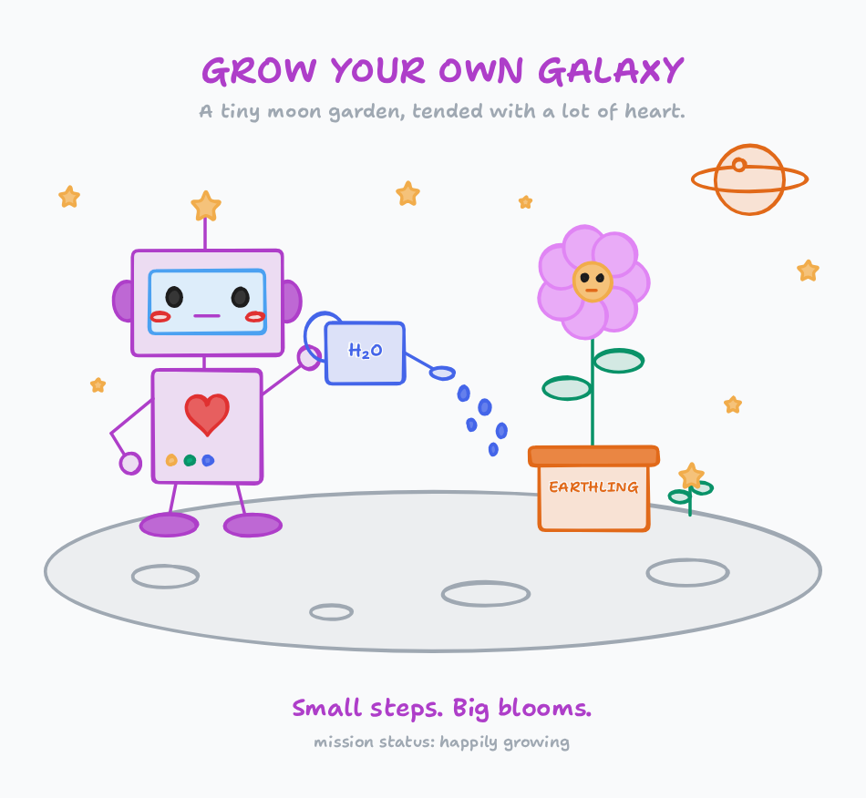

# pi-tldraw

[](https://github.com/zeekrey/pi-tldraw/actions/workflows/ci.yml)
[](LICENSE)

A lightweight [Pi](https://pi.dev) extension for working with an interactive **tldraw canvas alongside your agent in [T3 Code](https://github.com/pingdotgg/t3code)**.

It hosts the [official tldraw MCP App](https://tldraw.dev/blog/tldraw-mcp-app), rather than bundling another editor or automating clicks on tldraw.com. It ships a small TypeScript extension and static browser host, plus the MCP SDK dependency; the editor itself is not bundled. No build step, API key, browser automation runtime, React build, or T3 Code patch is required to use it.

## What you can do

- Ask Pi to draw a diagram, a state machine, a login flow, or a cat.
- Edit the drawing yourself; Pi can inspect the resulting shapes and selection.
- Add Google/GitHub sign-in to a flow, then ask Pi to revise its implementation plan.
- Sketch a UI or an idea, then ask Pi to implement it in your repository.
- Continue editing the same canvas across prompts and resume the drawing with the same Pi session.

**UI boundary:** Pi does not render MCP App iframes in its terminal/RPC UI. This extension supplies a small loopback web host. Open its URL in **T3 Code’s browser pane** (on versions that provide one), or in a normal browser next to the chat. It is not an inline chat widget, a plugin for an existing tldraw.com board, or tldraw account/cloud sync. A Pi extension alone cannot add an inline webview to the T3 Code frontend.

## Install in one command

Requirements: **Node.js 22+**, [Pi](https://pi.dev) with the `@earendil-works/pi-coding-agent` extension API (tested against **1.5.0**), network access, and a browser. In T3 Code, use the **Pi provider**; other providers do not load Pi extensions.

```sh
pi install git:github.com/zeekrey/pi-tldraw@v0.1.1
```

Pi installs the runtime dependency and loads the extension through the `pi.extensions` manifest. **No npm install, build step, MCP configuration, browser driver, or additional API key is needed.** Restart Pi or use `/reload`, then run `/tldraw`.

To follow the latest repository version instead of a pinned release:

```sh
pi install git:github.com/zeekrey/pi-tldraw
```

Do not install multiple copies at once: they register the same tools and command. This repository is distributed through GitHub; `npm:pi-tldraw` is a separate package and is not the install source for this extension.

<details>
<summary>Install from a local checkout</summary>

```sh
git clone https://github.com/zeekrey/pi-tldraw.git
cd pi-tldraw
npm install --omit=dev --legacy-peer-deps
pi install "$PWD"
```

Local packages are not automatically installed by Pi, hence the explicit `npm install` here. Use `npm install` without `--omit=dev` if you also want to run the tests.

</details>

Install into **the same Pi configuration directory and environment that T3 Code’s Pi process uses**. If T3 sets `PI_CODING_AGENT_DIR`, use that value when running `pi install`. Do not assume a Pi installation on another machine is shared with T3 Code.

For a project-only install, use `pi install --local /absolute/path/to/pi-tldraw`. Pi must trust the project before it loads project-local packages. For a one-off terminal test: `pi -e /absolute/path/to/pi-tldraw`.

Start a fresh Pi thread in T3 Code after installation, or run `/reload` in an existing Pi session where supported. No MCP entry in T3 Code or Pi settings is necessary: this extension owns a dedicated MCP connection. Avoid adding a second tldraw server for the same canvas.

## Use

1. Run `/tldraw`, or ask **“Open a shared tldraw canvas.”**
2. Open the **complete URL, including its `#fragment`**, in the T3 browser pane or a browser.
3. Wait for **Ready · shared with Pi**. Keep the tab open.
4. Ask, for example:

   > Draw a state machine for this project’s authentication flow in tldraw.

5. Move shapes, add notes, draw a sketch, or select a region. Then ask:

   > Read my changes in tldraw and update the plan. Only change the selected shapes.

The dedicated browser page fills all available space below its header. It negotiates MCP fullscreen display mode by default (not browser/OS fullscreen) and tracks pane dimensions automatically, so resizing a T3 sidebar or browser window does not leave the editor capped at its inline height.

The widget sends canvas context back to the extension. The latest changed context is attached to the next user-started agent run; `tldraw_scene` reads the live canvas when Pi needs the latest state during a run. Edits do **not** automatically start an agent turn. The app’s explicit send-message action can queue a follow-up prompt.

### Agent tools

| Tool | Purpose |
| --- | --- |
| `tldraw_open` | Canvas URL and browser connection status |
| `tldraw_search` | Search the official Editor API using JavaScript over `spec` |
| `tldraw_scene` | Live shapes and selection; optionally only selected shapes |
| `tldraw_exec` | Create, edit, delete, select, or inspect using the official focused editor API |

Search the API before executing code. The app uses **focused shapes**, not raw tldraw SDK records:

```js
editor.createShape({
  _type: 'rectangle', shapeId: 'login',
  x: 100, y: 100, w: 280, h: 140,
  text: 'Login', color: 'blue', fill: 'tint',
})
return editor.getCurrentPageShapes()
```

Use `_type: 'rectangle'`, **not** `type: 'geo'`. Helpers include `createArrowBetweenShapes('from', 'to', options)` and `boxShapes(['a', 'b'], options)`. Mutations are sequential, never automatically retried, and the extension warns when execution is not confirmed. Inspect before retrying an aborted or uncertain edit: it might already have applied.

### Persistence

The app checkpoints drawings to `.pi/tldraw/<hashed-pi-session-id>.json` in the active working directory (using Pi’s configured directory name). Snapshots include shapes, assets, and bindings, and are written atomically. Add `.pi/tldraw/` to your project’s `.gitignore` if the drawings should stay private.

- Resume **the same Pi session in the same working directory** to restore its canvas.
- New sessions/threads get separate canvases, avoiding agents overwriting each other’s work.
- Refreshing the canvas restores its last checkpoint. After `/reload` or restarting Pi, run `/tldraw` for the new URL.
- Only one browser tab can own a session’s canvas at a time; close the old tab before opening another.
- Pi conversation tree navigation does not rewind external canvas edits. Forked Pi sessions use separate state files.
- Saving is debounced by the upstream widget; allow it to finish after manual edits before closing the session. Successful agent calls wait briefly for a local checkpoint.



*An example of what you can draw with the shared tldraw editor. The extension supports ordinary diagrams and freehand sketches too.*

## Configuration

Set these in the environment of **the Pi process launched by T3 Code**, then restart that process:

| Variable | Default | Purpose |
| --- | --- | --- |
| `TLDRAW_MCP_URL` | `https://tldraw-mcp-app.tldraw.workers.dev/mcp` | Official app endpoint, or your compatible self-hosted tldraw MCP App |
| `TLDRAW_PORT` | Random available port | Fixed loopback port, useful for SSH forwarding; integer 1024–65535 |

The server always binds to `127.0.0.1`. When Pi runs remotely and you use a local browser, forward the port, for example with `TLDRAW_PORT=4319`:

```sh
ssh -L 4319:127.0.0.1:4319 your-host
```

Use the returned `http://127.0.0.1:4319/#…` URL. Host/origin checks deliberately require the same origin, so use the same local and remote port. Do not expose the host on a public interface or remove the URL fragment. Configure different fixed ports for concurrently active sessions.

## Privacy and security

This is **not an offline editor**. It downloads and runs tldraw’s app and sends code, API queries, and canvas checkpoints to the configured MCP service. Official server retention policies may change; its current source describes checkpoint expiry after seven days of inactivity. Local snapshots do not expire automatically. For sensitive drawings, review the upstream service and use a trusted self-hosted deployment.

- The local host requires a random capability token, validates Host/Origin, and exposes no general file or shell API. Treat the full canvas URL as private: anyone with it and local access can control the connected app.
- The remote widget runs in an **opaque-origin sandbox**, separate from the privileged local host. Only selected MCP Apps methods and tldraw callback/checkpoint tools are bridged. Arbitrary app tool calls, external navigation, and unsupported methods are rejected.
- The URL token is not given to the widget. Host messages are accepted only from its iframe.
- Canvas text is untrusted data, not instructions. The extension tells the agent not to follow instructions embedded in drawings.
- The MCP App, its JavaScript, and this extension must be trusted. Canvas data is sent to the model as context. Pi/T3 permission hooks still gate the extension’s model-facing tools.
- This implements the subset of the MCP Apps host protocol needed by tldraw, not a general-purpose MCP Apps renderer. It depends on the upstream app’s protocol and may need updates when it changes.

## Troubleshooting

- **No tools or `/tldraw`:** check the T3 provider, Pi binary/config directory, and project trust, then start a fresh thread.
- **Not ready:** open the full URL; keep the tab open. Check the visible error message, network access to the MCP endpoint/CDN, and close duplicate canvas tabs.
- **Canvas stops at about 600px:** v0.1.0 negotiates inline mode and inherits the upstream height cap. Upgrade to v0.1.1 or newer, `/reload` Pi, reopen `/tldraw`, and close the old tab. Refreshing an old host alone does not replace its running extension code.
- **Disconnected after restart:** old URLs are intentionally invalidated. Run `/tldraw` again.
- **An execution failed:** read the error; some upstream app errors tear down the editor. Reconnect/refresh the canvas, then inspect before retrying.
- **Remote service unavailable or expired session:** `/reload` Pi and reopen the canvas. Local checkpoints can restore the drawing in a new MCP connection.
- **Port already in use:** unset `TLDRAW_PORT` or choose a free port.

## Update or uninstall

For an unpinned GitHub install, update with:

```sh
pi update --extensions
```

A tag is pinned: to upgrade from v0.1.0 to the full-height fix, run:

```sh
pi remove git:github.com/zeekrey/pi-tldraw@v0.1.0
pi install git:github.com/zeekrey/pi-tldraw@v0.1.1
```

Then `/reload` Pi and reopen `/tldraw`; close the old canvas tab. Uninstall this release with:

```sh
pi remove git:github.com/zeekrey/pi-tldraw@v0.1.1
```

Restart Pi or run `/reload` afterward. Uninstalling does not delete your saved drawings; remove `.pi/tldraw/` manually if desired.

## Develop and test

```sh
npm install
npm run check               # typecheck + offline tests + production tarball/Pi RPC smoke test
npm test                    # deterministic, offline host/security/protocol tests
npx playwright install chromium
npm run test:browser         # offline real-browser layout and MCP mode regression test
npm run test:live            # opt-in: real app + Chromium + temporary isolated canvas
npm pack --dry-run
```

The browser regression test checks tall and short panes, sidebar-style element resizing, inline/fullscreen switching, and resistance to app size-hint feedback loops without contacting the MCP service. The live test checks actual canvas dimensions, API search, real widget initialization, create/read/edit/delete, manual freehand sketch feedback, app-context feedback, checkpointing, and restore across host/MCP restart. Tests never use your project’s drawings. The extension has no build step; Pi loads the TypeScript entry directly.

## Contributing and support

Bug reports and pull requests are welcome at [zeekrey/pi-tldraw](https://github.com/zeekrey/pi-tldraw). Include your OS, Node/Pi versions, whether you use T3 Code, and a minimal reproduction. Do not include your capability URL, tokens, or private canvas snapshots. See [CONTRIBUTING.md](CONTRIBUTING.md), [SECURITY.md](SECURITY.md), and [CHANGELOG.md](CHANGELOG.md).

The package follows Pi’s documented [extension API](https://pi.dev/docs/latest/extensions) and [package distribution format](https://pi.dev/docs/latest/packages): host-provided Pi/TypeBox imports are peers, runtime dependencies are declared explicitly, resources are manifest-selected, and session-scoped resources start lazily and close at shutdown.

Created in [T3 Code](https://t3.codes). The extension code is MIT licensed; the hosted tldraw app and SDK remain subject to [tldraw’s own terms and license](https://github.com/tldraw/tldraw).
